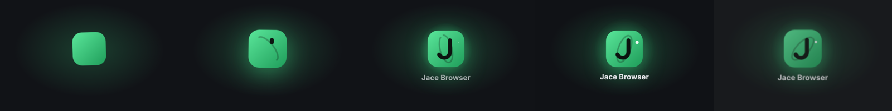
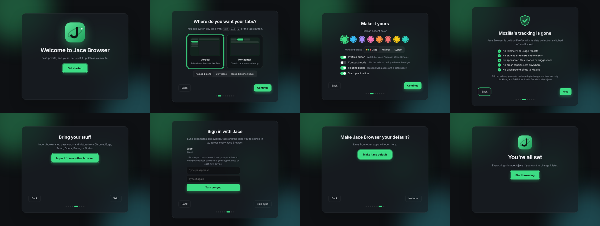
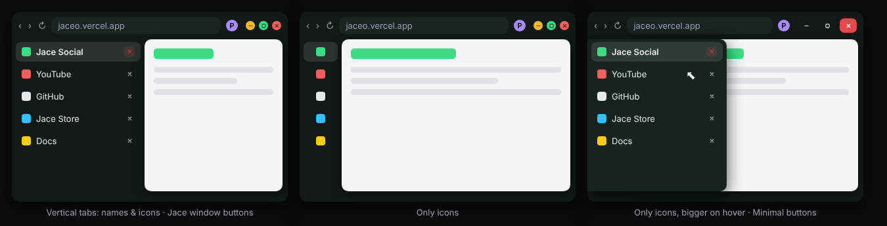

# Jace Browser

**A Firefox-based browser with a Zen-style look, Jace accounts, and sync that signs you in everywhere.**


**Startup animation**



**First-run setup**



## Features

- **Startup animation**: the Jace logo draws itself in (orbit ring, the J, a spark), "Jace Browser" rises up, and it all zooms away to the browser. About 1.6 seconds, drawn over the browser while it loads so it never slows startup. Press any key to skip; turn it off in about:jace. With "reduce motion" on it's a quick fade.
- **First-run setup** (about:jace-setup): pick vertical or horizontal tabs, an accent color and compact mode; import from Chrome, Edge, Safari, Opera, Brave or Firefox; sign in with Jace and turn on sync; make it your default browser. Run it again from about:jace.
- **Mozilla's tracking removed**: telemetry and Glean, studies and remote experiments, crash reports, sponsored content, ad measurement, recommendations and background pings are switched off **and locked** (`src/jace/autoconfig/jace.cfg` and `src/jace/policies/policies.json`), so nothing can turn them back on. Safe Browsing, security blocklists and the Widevine download stay on, because removing them makes you less safe or breaks DRM. The full list is in **about:jace → Privacy**.
- **Zen-style look**: the window is one soft surface, web pages float on it as a rounded card, tabs are pills, and the accent is Jace green (change it in about:jace).
- **Vertical tabs you can turn off**: on by default. Turn them off or on with the tabs button in the toolbar, **Ctrl+Alt+V** (**Cmd+Opt+V** on macOS), or **about:jace → Look**. Compact mode hides the sidebar until you hover the left edge.
- **Vertical tab styles**: names and icons, **only icons**, or **only icons that grow over the page when you hover**. Pick in the setup or **about:jace → Look**.
- **Profiles button**: shows which profile this window is (a colored letter) and switches between them, e.g. Personal, Work, School, each with its own tabs, passwords, add-ons and Jace account. Other profiles open in their own window. Hide it with **Hide this button** in its panel, Customize Toolbar, or **about:jace → Look**; profiles stay in **about:jace → Profiles**.
- **Custom window buttons and browser pieces**: minimize, maximize and close in Jace style (colored dots, or minimal) on Windows and Linux, or the system's own; macOS keeps its traffic lights. Tab close buttons, menus, panels and the address bar's suggestions are restyled to match, in your accent color.



*Mockup; the real browser draws these with Firefox.*
- **Jace account**: the account button signs you in with your [Jace](https://jaceo.vercel.app) account (okjace/Jace), the same way Jace OS does.
- **Signed in to Jace websites automatically**: once Jace Browser is signed in, so is the Jace website. Jace's own apps (Jace Social, Jace Store, …) sign you in without the "Sign in with Jace" consent screen, and apps that use `prompt=none` sign you in without a click. Not in private windows or container tabs. Turn it off in **about:jace → Jace account**.
- **Jace sync**: bookmarks, history (90 days), passwords, open tabs, settings, your add-on list, and **site sign-ins** (cookies).
  - Sign in to Jace on a new computer, enter your sync passphrase once, and you're signed in to the sites you were signed in to on your other devices.
  - Everything is encrypted on your device (AES-256-GCM, with a key made from your sync passphrase) before it goes to Jace, so Jace can't read it.
  - Tabs from your other devices are in the account panel; add-ons from your other devices are in about:jace with a **Get it** button.
  - Some sites tie a sign-in to one device or network and will still ask you to sign in.
- **WebUSB** (`navigator.usb`): Firefox doesn't have it, so Jace Browser adds it with a small native helper (`usb-helper/`).
  - A site only gets a device after you pick it.
  - Keyboards, mice, USB sticks, webcams, audio and other protected interfaces are blocked, the same as in Chrome.
  - Manage which sites can use which devices in about:jace.
- **DRM**: Widevine is on for **Windows and macOS** (and Linux). It downloads the first time a site needs it, so Netflix, Disney+, Spotify and the rest play.
- **Always on the newest Firefox, automatically**: see [Automatic Firefox updates](#automatic-firefox-updates).

Everything Jace-specific is in **about:jace**.

## Downloads for Windows, macOS and Linux

GitHub Actions builds every platform. The workflow is in `.github/workflows/build.yml`.

| Platform | File | Install |
|---|---|---|
| Windows 10/11 | `JaceBrowser-<ver>-windows-x64-setup.exe` | Run it and follow the installer. Uninstall from **Settings → Apps → Installed apps**. |
| Windows (portable) | `JaceBrowser-<ver>-windows-x64-portable.zip` | Unzip anywhere and run `jace.exe`. |
| macOS 12+ (Apple Silicon) | `JaceBrowser-<ver>-macos-arm64.dmg` | Open it and drag **Jace Browser** to **Applications**. |
| macOS 12+ (Intel) | `JaceBrowser-<ver>-macos-x86_64.dmg` | Same as above. |
| Linux | `JaceBrowser-<ver>-x86_64.AppImage` | `chmod +x` it and run it. |
| Linux (tar.xz) | `JaceBrowser-<ver>-linux-x86_64.tar.xz` | Unpack it and run `jace/jace`. |

Every push to `main` builds and tests all of these; download them from the run's **Artifacts**. Each installer is tested in CI:
1. it's installed the way a person would (silent setup on Windows; from a quarantined .dmg on macOS; the AppImage on Linux)
2. the installed browser starts headless and runs a self-test: the Zen skin, about:jace and the setup, the startup animation, that Mozilla's tracking is off and locked, that the policies are active, that this copy can update itself, the toolbar buttons, sync encryption, the USB helper, and DRM
3. it's uninstalled

## Automatic Firefox updates

Nobody has to do anything when Mozilla ships a new Firefox:

1. **Every day**, `.github/workflows/firefox-update.yml` asks Mozilla for the newest Firefox release. If it's newer than `firefox` in `jace.json` and its source is published, it moves `jace.json` to it, raises Jace Browser's version (1.0.3 → 1.0.4), adds a `CHANGELOG.md` entry, pushes to `main`, and starts the Build workflow.
2. **Build** builds every platform and tests every installer. If all of it passes, it publishes the release (and lists it on Jace Store). If anything fails, nothing is released and it opens a GitHub issue, so installed copies stay on the last good version.
3. **Every installed Jace Browser** checks GitHub every few hours. It downloads the new version in the background, checks it against the SHA-256 GitHub publishes for the file, and installs it when you quit, or right away with **Restart to update**. Your tabs come back.
   - Windows: the setup .exe installs silently over the installed copy (Windows may ask for permission, because it's in Program Files).
   - macOS: the app in Applications is replaced, and the old copy is kept until the new one is in place.
   - Linux: the AppImage file is swapped for the new one.
   - The portable .zip and .tar.xz can't replace themselves, so they show an **Update to vX** bar with the download instead.
   - Turn automatic installs off in **about:jace → About**.

To update right now instead of waiting for the daily run, open **Actions → Firefox update → Run workflow**. GitHub pauses scheduled workflows in repositories with no activity for 60 days; the update commits count as activity, but if it ever pauses, re-enable it on the Actions tab.

## Releasing

**Releasing is automatic** (same as Jace Launcher):
1. Raise `version` in `jace.json`.
2. Add a `## <version>` section to `CHANGELOG.md`.
3. Push to `main`.

If every build and test passes, CI tags `v<version>`, publishes the GitHub Release (with that changelog section as its notes), and lists it on [Jace Store](https://jace-store-deb.vercel.app/project/jace-browser). Pushes that don't change the version only build and test. Pushing a `v*` tag by hand still works too.

For Jace Store, add a `JACE_STORE_TOKEN` repository secret and create the `jace-browser` project once (`node packaging/jace-store.mjs create --type app --title "Jace Browser" --slug jace-browser --summary "..."`). Without the secret, that step is skipped.

**Build time:** Firefox is big. Each platform takes 2–5 hours on GitHub's free runners, within the 6-hour job limit. Pull requests only run the quick tests.

**Unsigned builds:** the apps aren't signed with paid Apple or Microsoft certificates, so:
- **macOS** says the app "can't be opened". Right-click it, choose **Open**, then **Open** again (only needed once). On macOS 15 and newer, go to **System Settings → Privacy & Security → Open Anyway** instead.
- **Windows SmartScreen** shows "Windows protected your PC". Click **More info → Run anyway**.

Some streaming services check that the browser is one they've approved (Widevine "VMP" signing, which needs an agreement with Google) and limit unapproved browsers to lower resolution. Jace Browser plays protected content, but may get SD instead of HD/4K on those services.

## Building it yourself

You need what Firefox needs: Python 3, ~40 GB of disk, and a few hours. Plus Rust (for the USB helper) and `pip install pillow`.

```bash
python3 scripts/build.py all
```

That downloads Firefox's source (checked against Mozilla's SHA-512 sums) to `engine/`, adds Jace Browser to it, builds it, and puts the installers in `dist/`. The steps on their own:

```bash
python3 scripts/build.py download
```

```bash
python3 scripts/build.py prepare
```

```bash
python3 scripts/build.py build
```

```bash
python3 scripts/build.py package
```

Windows builds are cross-compiled on Linux (`--platform windows`), the way Mozilla builds Firefox. macOS builds run on a Mac.

**Trying a change quickly:** everything Jace Browser adds loads through Firefox's autoconfig, so you can copy it into a regular Firefox and skip the build:

```bash
python3 scripts/dev-install.py "/Applications/Firefox.app"
```

Then start Firefox with a fresh profile and open about:jace. `--remove` undoes it.

**Updating Firefox:** change `firefox` in `jace.json`. Jace Browser changes only two lines of Firefox's own files (see `src/jace/README.md`), so new versions rarely need more.

## How it fits together

- `src/jace/`: the browser features (JavaScript modules, the skin, about:jace). See [`src/jace/README.md`](src/jace/README.md).
- `usb-helper/`: the native WebUSB helper (Rust, [nusb](https://crates.io/crates/nusb)).
- `branding/`: the logo; `scripts/build.py` turns it into every icon Firefox needs.
- `configs/`: build options (`mozconfig`), including `--enable-eme=widevine`.
- `tests/`: sync merge and encryption tests (`node --test tests/*.test.mjs`) and the Firefox auto-update script's tests (`python3 -m unittest discover -s tests -p "test_*.py"`).
- The server side is in [okjace/Jace](https://github.com/okjace/jace): the `sync` scope, the Jace Browser sign-in client, and `/api/oauth/sync`.

### Jace sync, in detail

1. **Sign in**: Jace Browser is an OAuth public client (`00000000-0000-0000-0000-000000000003`) that signs in with PKCE on `http://127.0.0.1:47613/jace-browser/callback` and asks for `profile sync`. The token is kept in the password manager.
2. **Sync passphrase**: the first device picks one; a key is derived from it (PBKDF2-SHA256, 600,000 rounds). Jace stores only the salt and a check value, so another device can tell if you typed the right one.
3. **Each collection** (bookmarks, history, passwords, cookies, tabs, prefs, addons) is one AES-256-GCM blob on Jace with a version number. Devices merge three ways (this device, Jace, and the last state they agreed on), so deletions and edits travel correctly and two devices syncing at once never overwrite each other.
4. Every 10 minutes, at sign-in, and with **Sync now**.

## License

[MPL 2.0](LICENSE), like Firefox. Firefox is a trademark of the Mozilla Foundation; Jace Browser is not made or endorsed by Mozilla.

**Built by Claude, made by Anthropic.**
